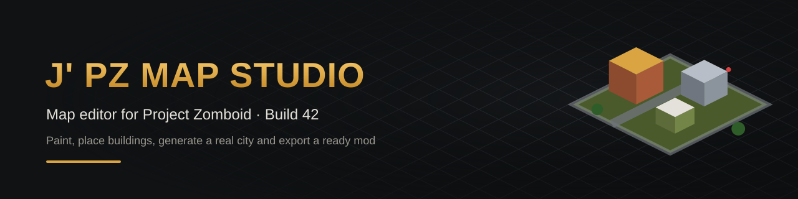
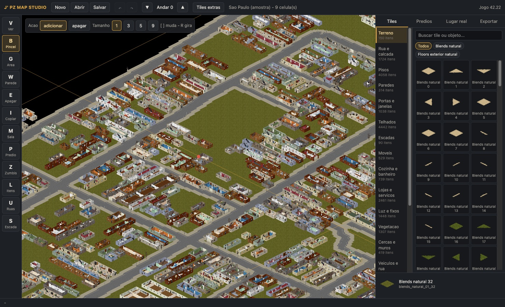
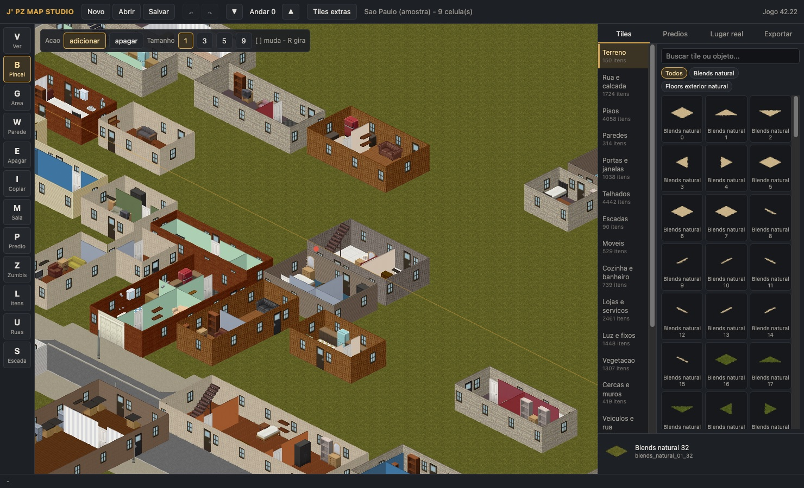
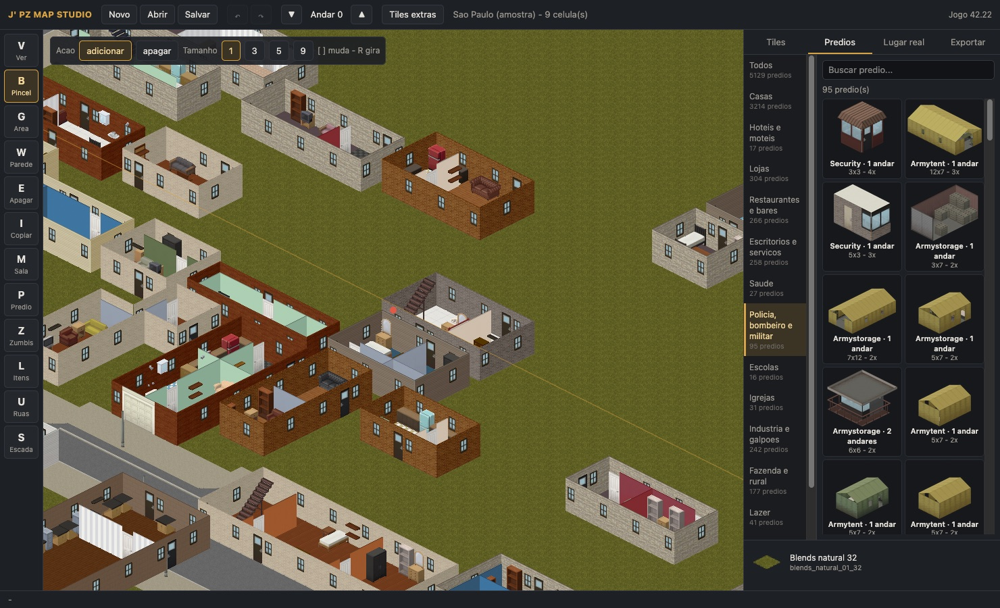
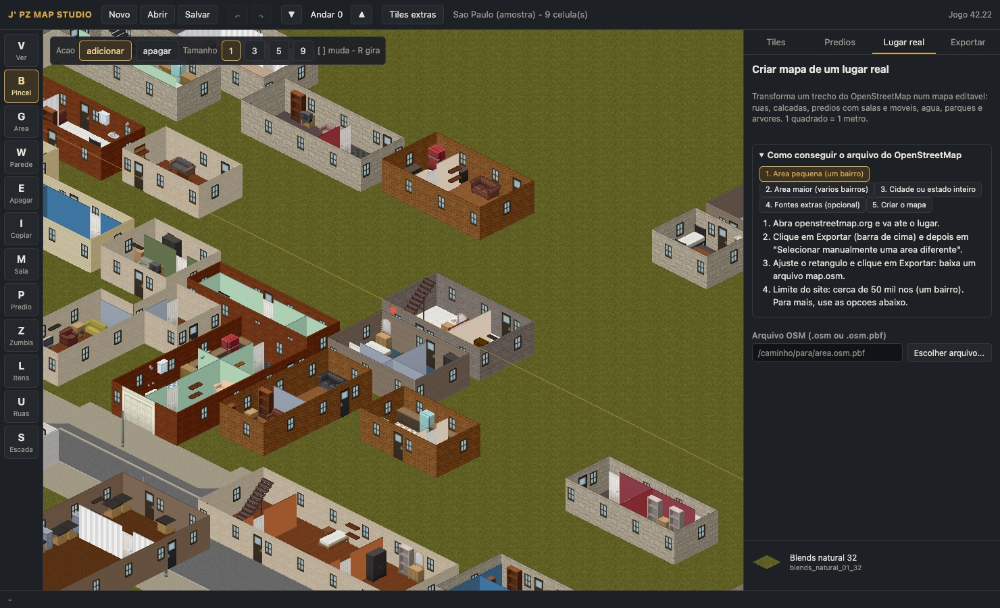

  

  
  
  
  
  

  🇧🇷 <a href="README.md">Português</a> · 🇺🇸 <b>English</b>

  <b>Create and edit Project Zomboid maps directly, with no WorldEd and no TileZed.</b> 
  Paint the ground, drop in ready-made vanilla buildings, turn a real OpenStreetMap neighborhood into a playable map 
  and export a ready Build 42 mod folder with one click.

  

  
   Part of São Paulo generated from OpenStreetMap: streets, sidewalks and buildings with rooms and furniture, all editable.

> The app's interface is in Portuguese (Brazil). Tools are icon-and-letter based, and the screenshots below
> show where everything is.

---

## ✨ What you can do

<table>
  <tr>
    <td width="50%" valign="top">
      
      <h3>🖌️ A real isometric editor</h3>
      An isometric view drawn with <b>your</b> game's sprites, floor by floor. Brush, area, wall, eraser,
      eyedropper and stairs, with undo and redo for everything. Almost 30,000 tiles sorted by type
      (floors, walls, roofs, furniture, signs…), with search.
    </td>
    <td width="50%" valign="top">
      
      <h3>🏠 A catalog of 5,000 vanilla buildings</h3>
      Every house, shop, police station, school, church, warehouse and military base from the vanilla map,
      with thumbnails, in 15 categories. Pick one, rotate it with <kbd>R</kbd> and place it with a click. They
      are read from your own game install; nothing is redistributed.
    </td>
  </tr>
  <tr>
    <td width="50%" valign="top">
      
      <h3>🌎 Generate a real place</h3>
      Give it an <b>OpenStreetMap</b> file and get a finished map: streets and avenues with lane markings and
      curbs, sidewalks, buildings with rooms and furniture, shops with the right loot, water, parks and trees.
      1 tile = 1 meter. An in-app tutorial shows how to get the file, from a neighborhood to a whole state.
    </td>
    <td width="50%" valign="top">
      <h3>🧟 Zombies, loot and rooms</h3>
      <ul>
        <li><b>Zombies:</b> paint the density (none, low, medium, high or a number) with a heat map on screen.</li>
        <li><b>Items:</b> choose what spawns in each container, room or area by mixing vanilla groups, single
            items and your own groups. The app exports the distribution Lua without overwriting vanilla.</li>
        <li><b>Rooms:</b> paint a room and give it a vanilla type (kitchen, pharmacy, gas station…), which sets its loot.</li>
        <li><b>Streets:</b> draw streets as lines and the app builds the asphalt, sidewalks, lanes and junctions.</li>
      </ul>
      <h3>📦 Exports a ready mod</h3>
      The app builds the Build 42 mod folder (lotheader, lotpack, chunkdata, map.info, spawnpoints,
      objects.lua and worldmap) straight into <code>~/Zomboid/mods</code>. It only rebuilds the cells that changed.
      It can also prepare the <b>Steam Workshop</b> upload (cover, workshop.txt, .vdf and the steamcmd command).
    </td>
  </tr>
</table>

> **Mod tiles:** the **Tiles extras** button lets you use tiles from mods you already have installed.

---

## 📥 Installation

> **Before you start:** you need **Project Zomboid Build 42 (42.21 or 42.22)** installed through Steam, and an
> internet connection the first time you install, to download a portable Python (the installer checks its
> sha256). You do **not** need to install Python, a compiler or anything else.

**1. Download** `jpzmapstudio-<version>.zip` from **[Releases](https://github.com/AkiraZ1/pz-map-editor/releases/latest)** and unzip it.

> 🛡️ **Checked on VirusTotal:** no antivirus engine flagged the 0.4.6 zip. [See the report](https://www.virustotal.com/gui/file/38baa6a6f26fb75ea9754ed5ef8b2fffabfd1bc925674de0930f3bcdb7ff4749).

**2. Run the installer** for your system:

<table>
  <tr>
    <th width="50%">🍎 macOS (Apple Silicon or Intel)</th>
    <th width="50%">🪟 Windows 10/11 (64-bit)</th>
  </tr>
  <tr>
    <td valign="top">
      Double-click <b><code>install.command</code></b>.  
      If macOS says the file is from an <i>unidentified developer</i>:
      <ol>
        <li>Open <b>System Settings → Privacy &amp; Security</b>;</li>
        <li>Scroll to the message about <code>install.command</code> and click <b>Open Anyway</b>.</li>
      </ol>
      The app goes to <code>~/Applications/J' PZ MAP STUDIO.app</code>.
    </td>
    <td valign="top">
      Double-click <b><code>install.cmd</code></b>.  
      If Windows shows a security warning, click <b>Run</b>
      (or <b>More info → Run anyway</b>).  
      The app goes to <code>%LOCALAPPDATA%\Programs\jpzmapstudio</code>, with shortcuts on the
      <b>Desktop</b> and in the <b>Start Menu</b>.
    </td>
  </tr>
</table>

**3. Done.** The app opens by itself when the install finishes.

<b>Why a script installer and not an .exe/.dmg?</b>

 

The executable is assembled **on your machine** from an official portable Python
([python-build-standalone](https://github.com/astral-sh/python-build-standalone)) and the dependencies that
already ship in the zip. That way it doesn't carry the "downloaded from the internet" flag, and SmartScreen and
Gatekeeper don't block the app every time you open it. Nothing is compiled: the installer only puts the pieces
together and creates the shortcut.

<b>Updating to a new version</b>

 

Download the new zip and run the installer again. If the app is open, the installer saves the project, closes
the app, swaps the version and reopens the same project. Your projects and settings are kept.

---

## 🚀 Getting started

1. **First launch:** the app finds Project Zomboid through Steam (or asks for the folder) and builds a
   low-resolution sprite cache. This takes a few minutes and only happens once.
2. **Novo** (New) → name the map and pick its size in cells (1 cell = 256 × 256 tiles).
3. Paint with the **Tiles** tab, place buildings with the **Predios** (Buildings) tab, or go to **Lugar real**
   (Real place) and generate a whole neighborhood.
4. **Exportar** (Export) → **Exportar mod**.
5. In game: **Mods** → enable your map → **New Game** → pick the map in the spawn location list.

<b>⌨️ Shortcuts</b>

 

| Key | Tool | | Key | Tool |
|---|---|---|---|---|
| <kbd>V</kbd> | View / inspect | | <kbd>M</kbd> | Room |
| <kbd>B</kbd> | Brush | | <kbd>P</kbd> | Building |
| <kbd>G</kbd> | Rectangle area | | <kbd>Z</kbd> | Zombies |
| <kbd>W</kbd> | Wall | | <kbd>L</kbd> | Items (loot) |
| <kbd>E</kbd> | Eraser | | <kbd>U</kbd> | Streets |
| <kbd>I</kbd> | Copy tile | | <kbd>S</kbd> | Stairs |
| <kbd>R</kbd> | Rotate | | <kbd>PgUp</kbd> / <kbd>PgDn</kbd> | Floor up / down |
| <kbd>Ctrl/Cmd</kbd>+<kbd>S</kbd> | Save | | <kbd>[</kbd> <kbd>]</kbd> | Brush size |

<b>🌎 Where to get the OpenStreetMap file</b>

 

| Size | Where | Format |
|---|---|---|
| A neighborhood | [openstreetmap.org](https://www.openstreetmap.org) → **Export** → select the area | `.osm` (up to ~50k nodes) |
| Several neighborhoods | [extract.bbbike.org](https://extract.bbbike.org) → draw the area → *Protocolbuffer (PBF)* | `.osm.pbf` |
| City or state | [download.geofabrik.de](https://download.geofabrik.de) → continent → country → region | `.osm.pbf` |

Then open the file in the **Lugar real** tab, choose the area on the map and click **Gerar** (Generate). The app
checks that the file covers the area and estimates the size and time before it starts.

---

## 💾 Where things live

| What | macOS | Windows |
|---|---|---|
| Projects | `~/J' PZ MAP STUDIO Projects` | `%USERPROFILE%\J' PZ MAP STUDIO Projects` |
| Cache and settings | `~/Library/Application Support/jpzmapstudio` | `%APPDATA%\jpzmapstudio` |
| Exported mods | `~/Zomboid/mods` | `%USERPROFILE%\Zomboid\mods` |

---

## 🛠️ For developers

- **App:** Python 3.12 with a local HTTP server (`app/pzms`) and a web UI (`app/ui`) in a native window
  (pywebview).
- **Real-place generator** (`app/pzms/spgen`): the heavy parts are in **Rust**. The source is in `genfast_rs/`
  (C ABI) and `genfast_py/` (PyO3). Binaries for mac-arm64, mac-x64 and win-x64 live in `spgen/bin/` and are
  built by `tools/build_rust.py`.
- **Package:** `tools/make_dist.py` builds the release zip. `tools/lock_wheels.py` pins the wheels for each
  target (version + sha256), and the installer installs exactly those with `--require-hashes`.
- **Run from source:** with Python 3.12 and the dependencies from `tools/requirements-<target>.txt` installed,
  `cd app && python -m pzms.main --browser` (opens in the browser).

Issues and pull requests are welcome.

---

## 📜 License and credits

- **J' PZ MAP STUDIO** is free software under the **[GNU GPL v3.0](LICENSE)**. Created by **Jemerson Barros**.
- Map data comes from **© [OpenStreetMap](https://www.openstreetmap.org/copyright)** contributors under the
  ODbL. If you publish a map generated from OSM, credit OpenStreetMap.
- Sprites, buildings and items are read from **your** copy of Project Zomboid. The app does not distribute any
  game files.
- *Project Zomboid* is a trademark of **The Indie Stone**. This is a fan project with no affiliation with The
  Indie Stone.

Made with ☕ and 🧟 in Brazil.

