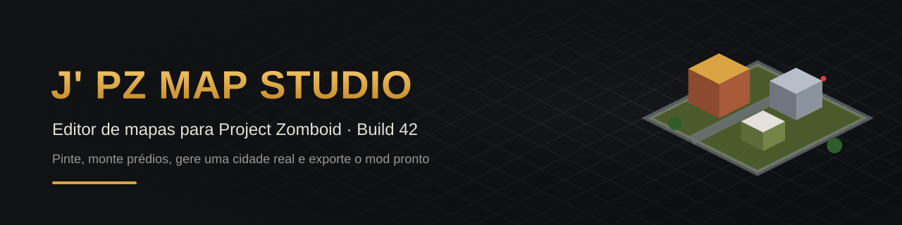
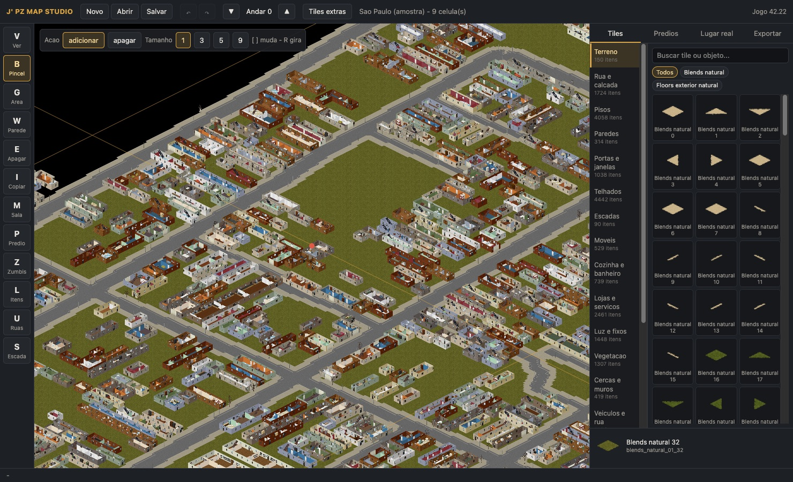
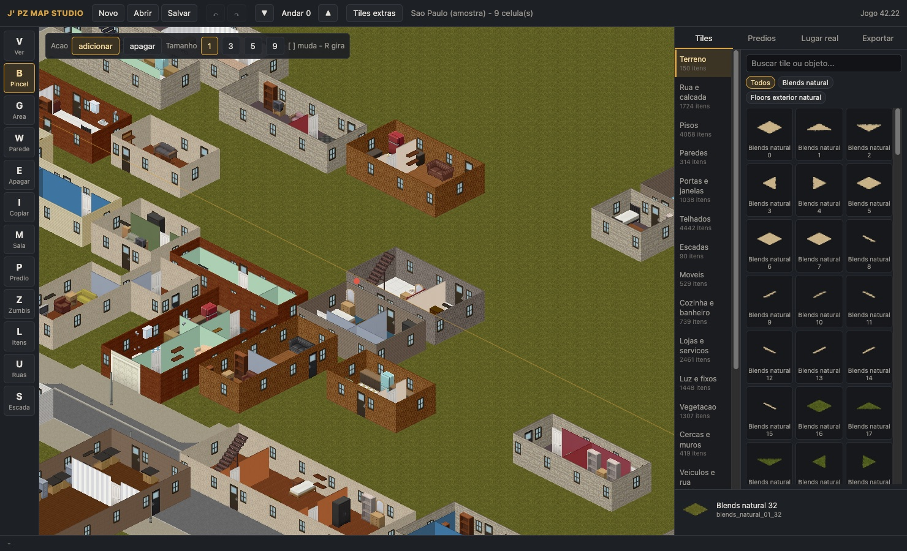
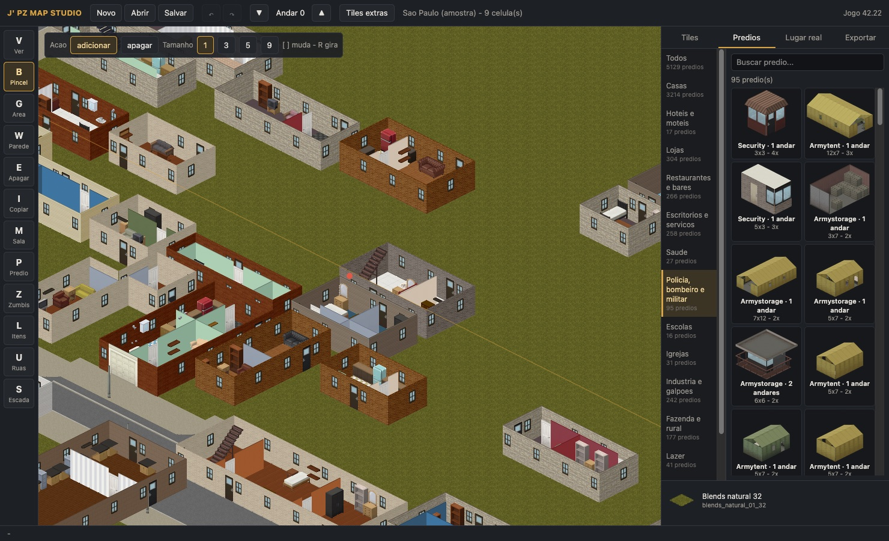
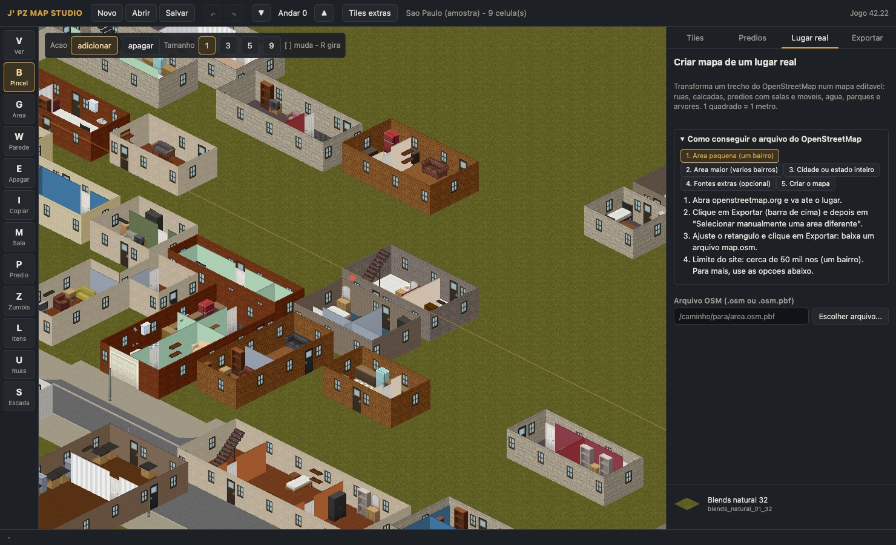

  

  
  
  
  
  

  🇧🇷 <b>Português</b> · 🇺🇸 <a href="README.en.md">English</a>

  <b>Crie e edite mapas do Project Zomboid direto, sem WorldEd e sem TileZed.</b> 
  Pinte o terreno, coloque prédios vanilla prontos, transforme um bairro real do OpenStreetMap em mapa jogável 
  e exporte a pasta do mod pronta para o Build 42, com um clique.

  

  
   Um trecho de São Paulo gerado do OpenStreetMap: ruas, calçadas e prédios com salas e móveis, tudo editável.

---

## ✨ O que dá pra fazer

<table>
  <tr>
    <td width="50%" valign="top">
      
      <h3>🖌️ Editor isométrico de verdade</h3>
      Visão isométrica com os sprites do <b>seu</b> jogo, andar por andar. Pincel, área, parede, borracha,
      conta-gotas e escada, com desfazer e refazer em tudo. São quase 30 mil tiles organizados por tipo
      (pisos, paredes, telhados, móveis, placas…), com busca.
    </td>
    <td width="50%" valign="top">
      
      <h3>🏠 Catálogo com 5 mil prédios vanilla</h3>
      Todas as casas, lojas, delegacias, escolas, igrejas, galpões e bases militares do mapa vanilla,
      com miniatura, em 15 categorias. Escolha, gire com <kbd>R</kbd> e coloque com um clique. Eles são
      lidos da sua instalação do jogo, nada é redistribuído.
    </td>
  </tr>
  <tr>
    <td width="50%" valign="top">
      
      <h3>🌎 Gere um lugar real</h3>
      Dê um arquivo do <b>OpenStreetMap</b> e receba o mapa pronto: ruas e avenidas com faixas e meio-fio,
      calçadas, prédios com salas e móveis, lojas com o loot certo, água, parques e árvores.
      1 quadrado = 1 metro. Um tutorial dentro do app ensina a baixar o arquivo, de um bairro até um estado.
    </td>
    <td width="50%" valign="top">
      <h3>🧟 Zumbis, loot e salas</h3>
      <ul>
        <li><b>Zumbis:</b> pinte a densidade (nenhuma, baixa, média, alta ou um número) com o mapa de calor na tela.</li>
        <li><b>Itens:</b> escolha o que nasce em cada container, sala ou área, misturando grupos vanilla, itens
            avulsos e grupos seus. O app exporta o Lua de distribuição sem sobrescrever o vanilla.</li>
        <li><b>Salas:</b> pinte uma sala e dê o tipo vanilla (cozinha, farmácia, posto…), que decide o loot.</li>
        <li><b>Ruas:</b> desenhe ruas como linhas e o app monta asfalto, calçada, faixas e cruzamentos.</li>
      </ul>
      <h3>📦 Exporta o mod pronto</h3>
      O app monta a pasta do mod para o Build 42 (lotheader, lotpack, chunkdata, map.info, spawnpoints,
      objects.lua e worldmap) direto em <code>~/Zomboid/mods</code>. Ele só refaz as células que mudaram.
      Se quiser, já prepara a <b>Steam Workshop</b> (capa, workshop.txt, .vdf e o comando do steamcmd).
    </td>
  </tr>
</table>

> **Tiles de mods:** o botão **Tiles extras** deixa usar os tiles dos mods que você já tem instalados.
>
> 🌐 **Português e inglês:** o app abre em português quando o sistema está em português e em inglês nos outros
> idiomas. Dá para trocar a qualquer hora em **Sobre** (clique no nome do app, no canto de cima). Os
> instaladores também seguem o idioma do sistema.

---

## 📥 Instalação

> **Antes de começar:** você precisa do **Project Zomboid Build 42 (42.21 ou 42.22)** instalado pela Steam,
> e de internet na primeira instalação, para baixar um Python portátil (o instalador confere o sha256).
> Você **não** precisa instalar Python, compilador nem nada além disso.

**1. Baixe** o `jpzmapstudio-<versão>.zip` em **[Releases](https://github.com/AkiraZ1/pz-map-editor/releases/latest)** e descompacte.

> 🛡️ **Verificado no VirusTotal:** nenhum antivírus acusou o zip da 0.5.1. [Ver o relatório](https://www.virustotal.com/gui/file/10028ea3a66c48a6f02f6591b5ad5a08fa50481d3cd35ac0dc72f2fd2ca4663e).

**2. Rode o instalador** do seu sistema:

<table>
  <tr>
    <th width="50%">🍎 macOS (Apple Silicon ou Intel)</th>
    <th width="50%">🪟 Windows 10/11 (64 bits)</th>
  </tr>
  <tr>
    <td valign="top">
      Dê dois cliques em <b><code>install.command</code></b>.  
      Se o macOS disser que o arquivo é de um <i>desenvolvedor não identificado</i>:
      <ol>
        <li>Abra <b>Ajustes do Sistema → Privacidade e Segurança</b>;</li>
        <li>Desça até a mensagem do <code>install.command</code> e clique em <b>Abrir Mesmo Assim</b>.</li>
      </ol>
      O app vai para <code>~/Applications/J' PZ MAP STUDIO.app</code>.
    </td>
    <td valign="top">
      Dê dois cliques em <b><code>install.cmd</code></b>.  
      Se o Windows mostrar um aviso de segurança, clique em <b>Executar</b>
      (ou <b>Mais informações → Executar assim mesmo</b>).  
      O app vai para <code>%LOCALAPPDATA%\Programs\jpzmapstudio</code>, com atalhos na
      <b>Área de Trabalho</b> e no <b>Menu Iniciar</b>.
    </td>
  </tr>
</table>

**3. Pronto.** O app abre sozinho no fim da instalação.

<b>Por que um instalador por script, e não um .exe/.dmg?</b>

 

O executável é montado **na sua máquina**, a partir de um Python portátil oficial
([python-build-standalone](https://github.com/astral-sh/python-build-standalone)) e das dependências que já vêm
prontas no zip. Por isso ele não leva a marca de "baixado da internet", e o SmartScreen e o Gatekeeper não
bloqueiam o app toda vez que você abre. Nada é compilado: o instalador só junta as peças e cria o atalho.

<b>Atualizar para uma versão nova</b>

 

Baixe o zip novo e rode o instalador de novo. Se o app estiver aberto, o instalador salva o projeto, fecha o
app, troca a versão e reabre no mesmo projeto. Seus projetos e configurações não são apagados.

---

## 🚀 Primeiros passos

1. **Primeira abertura:** o app acha o Project Zomboid pela Steam (ou pergunta a pasta) e monta um cache dos
   sprites em baixa resolução. Isso leva alguns minutos e só acontece uma vez.
2. **Novo** → dê um nome ao mapa e escolha o tamanho em células (1 célula = 256 × 256 quadrados).
3. Pinte com a aba **Tiles**, coloque construções com a aba **Prédios**, ou vá em **Lugar real** e gere um
   bairro inteiro.
4. **Exportar** → **Exportar mod**.
5. No jogo: **Mods** → ative o seu mapa → **Novo jogo** → escolha o mapa na lista de locais de início.

<b>⌨️ Atalhos</b>

 

| Tecla | Ferramenta | | Tecla | Ferramenta |
|---|---|---|---|---|
| <kbd>V</kbd> | Ver / inspecionar | | <kbd>M</kbd> | Sala |
| <kbd>B</kbd> | Pincel | | <kbd>P</kbd> | Prédio |
| <kbd>G</kbd> | Área retangular | | <kbd>Z</kbd> | Zumbis |
| <kbd>W</kbd> | Parede | | <kbd>L</kbd> | Itens (loot) |
| <kbd>E</kbd> | Borracha | | <kbd>U</kbd> | Ruas |
| <kbd>I</kbd> | Copiar tile | | <kbd>S</kbd> | Escada |
| <kbd>R</kbd> | Girar | | <kbd>PgUp</kbd> / <kbd>PgDn</kbd> | Andar acima / abaixo |
| <kbd>Ctrl/Cmd</kbd>+<kbd>S</kbd> | Salvar | | <kbd>[</kbd> <kbd>]</kbd> | Tamanho do pincel |

<b>🌎 Onde conseguir o arquivo do OpenStreetMap</b>

 

| Tamanho | Onde | Formato |
|---|---|---|
| Um bairro | [openstreetmap.org](https://www.openstreetmap.org) → **Exportar** → selecione a área | `.osm` (até ~50 mil nós) |
| Vários bairros | [extract.bbbike.org](https://extract.bbbike.org) → desenhe a área → *Protocolbuffer (PBF)* | `.osm.pbf` |
| Cidade ou estado | [download.geofabrik.de](https://download.geofabrik.de) → continente → país → região | `.osm.pbf` |

Depois é só abrir o arquivo na aba **Lugar real**, escolher a área no mapa e clicar em **Gerar**. O app confere
se o arquivo cobre a área e estima o tamanho e o tempo antes de começar.

---

## 💾 Onde ficam as coisas

| O quê | macOS | Windows |
|---|---|---|
| Projetos | `~/J' PZ MAP STUDIO Projects` | `%USERPROFILE%\J' PZ MAP STUDIO Projects` |
| Cache e configurações | `~/Library/Application Support/jpzmapstudio` | `%APPDATA%\jpzmapstudio` |
| Mods exportados | `~/Zomboid/mods` | `%USERPROFILE%\Zomboid\mods` |

---

## 🛠️ Para quem quer mexer no código

- **App:** Python 3.12 com servidor HTTP local (`app/pzms`) e interface web (`app/ui`) numa janela nativa
  (pywebview).
- **Gerador de lugar real** (`app/pzms/spgen`): partes pesadas em **Rust**. O código fonte está em
  `genfast_rs/` (ABI C) e `genfast_py/` (PyO3). Os binários para mac-arm64, mac-x64 e win-x64 ficam em
  `spgen/bin/` e são gerados por `tools/build_rust.py`.
- **Pacote:** `tools/make_dist.py` monta o zip da release. `tools/lock_wheels.py` fixa as wheels de cada alvo (versão + sha256),
  e o instalador usa exatamente essas, com `--require-hashes`.
- **Rodar do código:** com Python 3.12 e as dependências de `tools/requirements-<alvo>.txt` instaladas,
  `cd app && python -m pzms.main --browser` (abre no navegador).

Issues e pull requests são bem-vindos.

---

## 📜 Licença e créditos

- **J' PZ MAP STUDIO** é software livre sob a **[GNU GPL v3.0](LICENSE)**. Criado por **Jemerson Barros**.
- Os dados de mapa vêm do **© [OpenStreetMap](https://www.openstreetmap.org/copyright)** e seus colaboradores,
  sob a licença ODbL. Se você publicar um mapa gerado do OSM, dê o crédito ao OpenStreetMap.
- Sprites, prédios e itens são lidos da **sua** cópia do Project Zomboid. O app não distribui nenhum arquivo
  do jogo.
- *Project Zomboid* é marca da **The Indie Stone**. Este projeto é feito por fã, sem vínculo com a The Indie
  Stone.

Feito com ☕ e 🧟 no Brasil.

